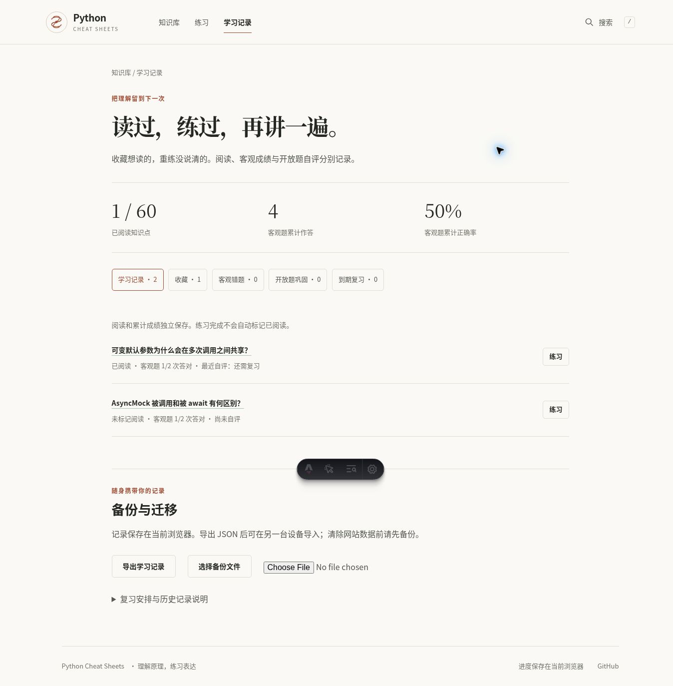

# S2 内容扩充与复习

基于已合并 PR #1，main 基线 `fdc778ae07f666914675252e112a541c1b964215`。本批保留 S1 的站点结构与算法视觉，不实施 S3 速查页或账号系统。

## 交付范围

- 60 篇知识点、240 道练习、60 个独立 Python 示例与发布输出。
- 三条学习路线：核心 32 篇、后端与 AI 服务 27 篇、测试开发 26 篇；路线引用同一份正文。
- 收藏与阅读独立；客观错题、开放题巩固、到期复习和收藏练习。
- 每题重练入口、队列随机练习、已纠正题目的本轮会话恢复和重复提交去重。
- v1 兼容迁移、JSON 导出、导入预览/取消/确认替换、导入前原始快照下载。
- 无效文件、未知版本、未知引用、存储失败和旧会话失效的处理。

## 本地验证

- Astro / TypeScript：0 错误、0 警告。
- 19 项行为测试通过，覆盖 S1 行为及迁移、队列、复习间隔、幂等计分、导入往返、重复导入和失败保护。
- 60 个示例和 60 道输出题在本地 CPython 3.12 执行通过。
- 构建 69 个 HTML 文件（68 个站点页面与 1 个独立画布），Pagefind 索引 60 篇正文。
- 内部链接与 `/python-cheat-sheets/` 子路径检查。

## GitHub Actions 与浏览器

[CI #6](https://github.com/captainamari/python-cheat-sheets/actions/runs/44508679200) 全部通过，验证实现提交 `8921a57dff47bdc79488dbeb3fdf604427bd640c`。

- site：类型检查、19 项行为测试、60 道代码输出、内容校验、构建与静态链接检查通过。
- Playwright：桌面与 iPhone 13 尺寸 Chromium 共 16 项测试通过，无重试失败；覆盖收藏、错题纠正、队列恢复、自评分离、导出、预览替换、重复导入、S1 迁移、坏文件、取消和写入失败保护。
- CPython 3.12、3.13、3.14：每个版本的 60 个示例均通过。

实际桌面浏览器验证了新增正文、收藏、收藏练习、错题出现与纠正、刷新恢复、历史成绩保留及 JSON 导出。手工上传备份未获得浏览器授权，未继续尝试；此项手工限制不替代或否定上述已完成的 CI 导入回归。手机尺寸测试不代表真实 iOS Safari 验证。

收尾补充了时间戳为 0 的旧阅读记录展示边界，及“最多 10 题”的准确提示；对应最新 CI 结果见 PR #2。

## 记录语义

S1 累计成绩不重置，历史错题不从聚合数字推测。导入是替换快照，不是合并；重复导入不累加成绩。复习间隔是明确的本地建议，不能用来认定掌握。记录保存在当前浏览器，清除网站数据会丢失，请主动备份；并发标签页写入仍可能互相覆盖。

PR 不发布、不自动合并；用户合并 main 后按现有 Pages 工作流发布。
