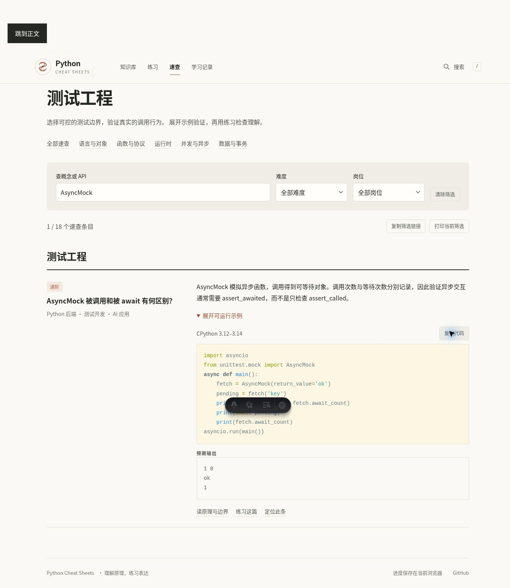

# S3 内容补齐与速查

基于已合并 PR #2，main 基线 `08785f0e815ac33b4ea95a9ec0f2b0f22e0cfe10`。本批补齐既定内容范围并提供速查视图，延续 S1 视觉和 S2 学习记录语义。

## 交付范围

| 分类 | S2 | S3 | 本批重点 |
| --- | ---: | ---: | --- |
| 语言与对象 | 13 | 23 | 数值边界、解包、切片、集合、字典合并、模式匹配 |
| 函数与协议 | 12 | 22 | 生成器通信、异步迭代、动态上下文、绑定与运算协议 |
| 运行时 | 9 | 19 | 对象构造、属性钩子、类型收窄、注解、模块与子进程 |
| 并发与异步 | 10 | 20 | 通知与条件、取消边界、进程池、线程复用与结果顺序 |
| 数据与事务 | 8 | 18 | NULL、约束、WAL、索引、分页、数据与路径边界 |
| 测试工程 | 8 | 18 | 环境隔离、Mock 记录、断言、发现、随机与不变量测试 |
| 合计 | 60 | 120 | 480 道练习、120 个可执行示例 |

三条路线分别为核心 62 篇、后端与 AI 服务 51 篇、测试开发 41 篇；允许交叉引用，每篇至少进入一条路线。S1/S2 知识点和题目 ID 保持不变。

速查包含一个总览和六个分类页，支持关键词、分类、难度、岗位组合筛选；状态保存在 URL，可刷新、分享。示例可展开与复制，正文和练习可直接跳转。打印保留当前筛选条目及已展开示例。关闭 JavaScript 后仍能阅读规则、代码和输出。速查复用正文元数据和 examples，不建立第二份正文或重复搜索结果，不写学习记录。

## 本地与实际页面验证

- Astro / TypeScript：0 错误、0 警告。
- 22 项行为测试通过，包括筛选组合、规范化、查询参数恢复与既有学习记录行为。
- CPython 3.12：120 个独立示例与 120 道输出题实际执行通过。
- 构建 136 个 HTML 文件，Pagefind 只索引 120 篇正文。
- 静态验收检查内部链接、部署 base、7 个速查页面和条目完整覆盖。
- 实际桌面浏览器：组合筛选、空结果、清除、刷新恢复、复制筛选链接、展开和复制代码、正文跳转、正文返回分类速查均可用。

## GitHub Actions

[CI #9](https://github.com/captainamari/python-cheat-sheets/actions/runs/44516827935) 全部通过，验证实现提交 `8f97ecf4a537602a9b198daf0455bc4d79da80d3`。

- site：类型检查、22 项行为测试、120 道输出题、内容校验、构建及静态链接检查通过。
- Playwright：桌面与 iPhone 13 尺寸 Chromium 共 22 项测试通过，14.7 秒完成，无重试失败。覆盖速查筛选/刷新、打印过滤、关闭脚本阅读，以及 S2 的收藏、错题、自评、导入导出和存储失败。
- CPython 3.12、3.13、3.14：每个版本的 120 个独立示例均通过。
- 路线引用无遗漏，既有 60 篇正文及其题目内容未修改。

本次构建速查总览 HTML 为 424,863 字节，gzip 后 47,069 字节；这是构建产物测量，不代表生产服务已启用 gzip。当前保留全部条目的静态渲染，避免依赖客户端加载后才能查阅。

后续文档收尾提交的检查状态以 PR #3 最新 CI 为准。

## 边界

示例验证范围为标准库、CPython 3.12–3.14；版本敏感行为采用明确选项并在正文说明。示例不联网，不连接真实业务服务。打印采用浏览器打印样式，不承诺不同打印机分页完全一致。手机尺寸 Chromium 回归不等于真实 iOS Safari 验证。

学习记录仍在当前浏览器保存，沿用 S2 导入导出和恢复规则。本批不新增账号、在线代码执行、自动同步或后端。PR 不发布、不自动合并，合并 main 后沿用 Pages 工作流。

## Vercel 自动部署补充

S3 PR 增补 GitHub → Vercel Git 集成支持：自动使用根路径、生产域名 canonical，固定 Node 24.x，并通过 vercel.json 构建完整搜索索引及校验静态产物。默认 Pages 子路径继续可用，接入步骤见 README。

本地类型检查、24 项行为测试、120 个示例与 120 道输出题通过；Pages 与 Vercel 两种配置均构建并通过 136 页静态验收。CI 增加两种部署模式，各执行桌面/手机尺寸的完整 22 项浏览器测试；远程结果以 PR 最新检查为准。

本批交付仓库配置，不代替在用户 Vercel 账号中首次导入仓库，未宣称已在 Vercel 上线。
